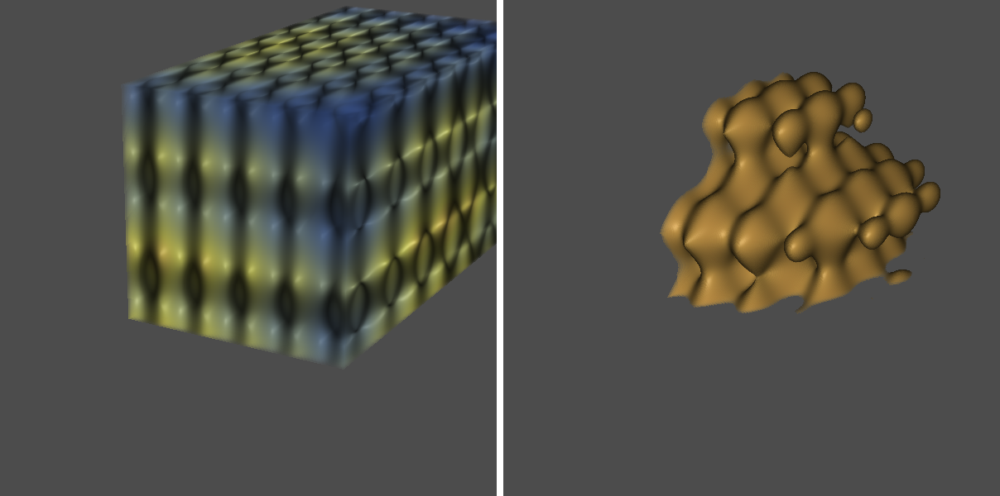

## Add transfer function based clipping to GPU volume rendering

You can now clip GPU ray-cast volumes based on the opacity transfer function
using the new `vtkVolumeProperty::TFClipping` and
`vtkVolumeProperty::TFClippingThreshold` properties.

When enabled, every sample whose opacity - as mapped by the scalar opacity
transfer function (and the gradient opacity transfer function, when active) -
is strictly lower than the threshold is discarded during ray casting. This
produces sharp cut surfaces along the opacity boundaries of the transfer
function, without having to modify the transfer function itself:

```cpp
vtkNew<vtkVolumeProperty> property;
// ... set color and scalar opacity transfer functions ...
property->TFClippingOn();
property->SetTFClippingThreshold(0.5); // in [0, 1], default is 0.5
```

Transfer function clipping composes with the regular geometric clipping
planes set with `vtkAbstractMapper3D::SetClippingPlanes()`, so multiple clip
planes can be combined with transfer function clipping. It is currently
supported by `vtkGPUVolumeRayCastMapper` (and therefore by
`vtkSmartVolumeMapper` when it falls back to GPU ray casting) for the
composite blend mode, and is ignored when rendering multiple volumes
(`vtkMultiVolume`) or label maps.

See the new `Examples/VolumeRendering/Cxx/TFClippingExample` example for a
complete demonstration.


