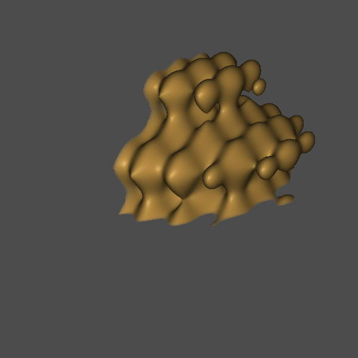

# Volume Rendering Examples

## TFClippingExample

Demonstrates transfer function based clipping in GPU volume rendering
(`vtkVolumeProperty::TFClipping` and `vtkVolumeProperty::TFClippingThreshold`)
combined with multiple geometric clipping planes
(`vtkAbstractMapper3D::SetClippingPlanes`).

Every sample whose opacity - as mapped by the scalar opacity transfer
function - is below the threshold is discarded during ray casting, which
produces sharp cut surfaces along the opacity boundaries of the transfer
function without modifying the transfer function itself.

Usage:

```
TFClippingExample [threshold] [--screenshot output.png]
```

- `threshold`: opacity threshold in [0, 1] (default: 0.5). 0 disables the
  effect, 1 clips everything that is not fully opaque.
- `--screenshot`: render offscreen and write the result to a PNG file
  instead of starting the interactor.


